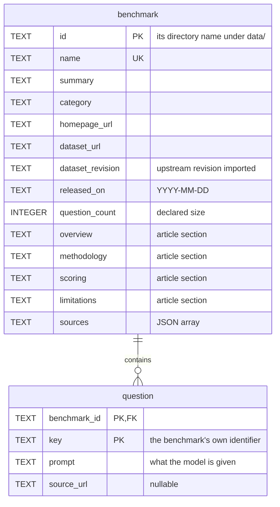

# Benchopedia

The encyclopedia of AI benchmarks: one readable page per benchmark, with an at-a-glance view of which benchmarks are saturated and which still have headroom.

## How it works

`data/` is the source of truth: one directory per benchmark, holding `benchmark.json` and `questions.jsonl`.

```sh
python3 scripts/build.py
```

loads everything into `build/benchopedia.db` (SQLite) and fails if any constraint in `schema.sql` or any check query is violated. A check is a `SELECT` that returns the rows breaking a rule; shared checks live in `checks/`.

`scripts/import_<benchmark>.py` re-snapshots a benchmark's questions from its upstream dataset.

## Schema

`schema.sql` is authoritative, including the `CHECK` constraints not shown here.



## Build the website

```sh
python3 scripts/build_site.py # Rebuild and validate SQLite, then generate the website in dist/.
python3 scripts/check_site.py # Check generated pages, internal links, and original prompt fidelity.
node scripts/check_ui.cjs     # Test search, filters, and pagination without a browser.
python3 -m http.server 8765 --directory dist
```

Open http://localhost:8765. Python 3.9+ with SQLite 3.37+ is required; there are no
third-party build dependencies. JavaScript adds search, filters and
pagination. Articles and every question also have their own static HTML pages.
The optional UI checks use Node.js and exercise the browser logic without external
test packages.

The website build first rebuilds and validates SQLite, then reads it to generate
`dist/`. It includes the benchmark index, article pages, a question library,
individual question pages and prompt copying. Generated files and the
database are ignored by Git.

The interface is a compact archive: benchmarks listed by release year, numbered
question lists, and single-column reference pages. All fonts and assets are local.

`web/assets/` holds the stylesheet and browser code. `scripts/build_site.py`
holds the page templates. `benchmark.json` also holds the benchmark's article:
its overview, methodology, scoring and limitations sections and its primary
sources. Article text supports paragraphs, headings, code blocks, inline code
and HTTP(S) links. Source HTML is escaped.

To add a benchmark, add its metadata, article and questions under `data/<id>/`,
then rebuild. Counts, navigation
and search indexes are generated from the database. Each question stores its
benchmark link, key, prompt and optional source URL.

The first version includes SWE-bench Verified. Model results and saturation
indicators await sourced score data.
