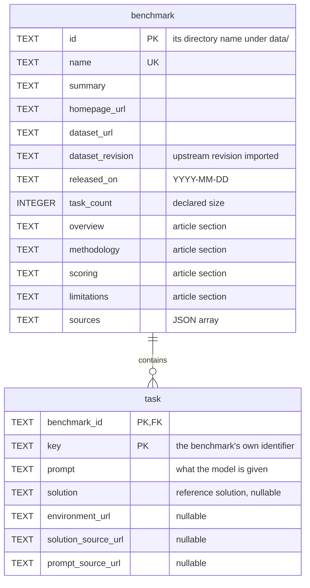

# Benchopedia

The encyclopedia of AI benchmarks: one readable page per benchmark, with an at-a-glance view of which benchmarks are saturated and which still have headroom.

## How it works

For the full import and verification process, see [Adding a benchmark](docs/adding-a-benchmark.md).

`data/` is the source of truth: one directory per benchmark, holding `benchmark.json` and `tasks.jsonl`.

```sh
python3 scripts/helpers/build_sqlite.py
```

loads everything into `build/benchopedia.db` (SQLite) and fails if any constraint in `db/schema.sql` or any check query is violated. A check is a `SELECT` that returns the rows breaking a rule; shared checks live in `checks/`.

`scripts/build_site.py` calls this helper automatically before generating the website.

`data/<benchmark>/import.py` re-snapshots a benchmark's tasks from its upstream dataset. For SWE-bench Verified:

```sh
python3 data/swe-bench-verified/import.py
```

MMLU includes the complete `cais/mmlu` `all/test` split. Its importer downloads
the Parquet file at the pinned dataset revision and requires PyArrow only when
refreshing that snapshot. Use an isolated environment, for example:

```sh
python3 -m venv /tmp/benchopedia-mmlu-import
/tmp/benchopedia-mmlu-import/bin/python -m pip install pyarrow
/tmp/benchopedia-mmlu-import/bin/python data/mmlu/import.py
```

MMLU task prompts include the original text and all four choices. Reference
solutions contain the answer letter and choice text. Task IDs use the subject
and one-based position in the pinned `all/test` file. No environment URL is
needed for these text tasks.

## Schema

`db/schema.sql` is authoritative, including the `CHECK` constraints not shown here.



## Build the website

```sh
python3 scripts/build_site.py # Rebuild and validate SQLite, then generate the website in dist/.
python3 scripts/check_site.py # Check generated pages, links, prompts and solutions.
node scripts/check_ui.cjs     # Test search, filters, and pagination without a browser.
python3 -m http.server 8765 --directory dist
```

Open http://localhost:8765. Python 3.9+ with SQLite 3.37+ is required; there are no
third-party build dependencies. JavaScript adds search, filters and
pagination. Articles and every task also have their own static HTML pages.
The optional UI checks use Node.js and exercise the browser logic with fictional
fixtures, without external test packages or a generated site. They do not depend
on which benchmarks have been imported.

The website build first rebuilds and validates SQLite, then reads it to generate
`dist/`. It includes the benchmark index, article pages, a task library,
individual task pages, and reference solutions when available. Generated files and the
database are ignored by Git.

The interface is a compact archive: benchmarks listed by release year, numbered
task lists, and single-column reference pages. All fonts and assets are local.

`assets/` holds the stylesheet and browser code. `scripts/build_site.py`
holds the page templates. `benchmark.json` also holds the benchmark's article:
its overview, methodology, scoring and limitations sections and its primary
sources. Article text supports paragraphs, headings, code blocks, inline code
and HTTP(S) links. Source HTML is escaped.

To add a benchmark, add its metadata, article and tasks under `data/<id>/`,
then rebuild. Counts, navigation
and search indexes are generated from the database. Each task stores its
benchmark link, key, prompt, optional reference solution, and optional URLs for
the prompt source, task environment and solution source.

For SWE-bench Verified, `solution` contains the upstream `patch`: the reference
code changes that fixed the issue. Task pages link to the task's official
Dockerfile above Task Prompt. The Dockerfile link is pinned to the
`TASK_REPO_REVISION` commit in `import.py`, independently of the dataset revision.
The Solution section links to the original pull
request's files and shows the reference patch in a collapsible section. The pull
request can include additional changes, such as tests, beyond the reference patch.
These links are generated by the importer from the upstream repository and task ID.

The catalog includes SWE-bench Verified and MMLU. Model results and saturation
indicators await sourced score data.
