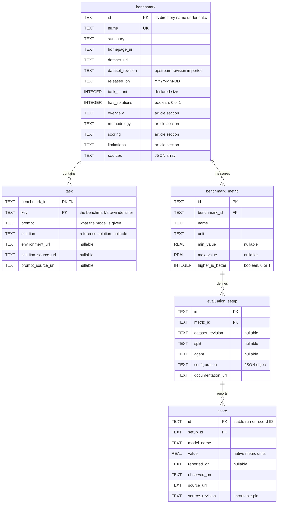

# Benchopedia

The encyclopedia of AI benchmarks: one readable page per benchmark, with an at-a-glance view of which benchmarks are saturated and which still have headroom.

## How it works

For the full import and verification process, see [Adding a benchmark](docs/adding-a-benchmark.md).

`data/` is the source of truth: one directory per benchmark, holding `benchmark.json`
and `tasks.jsonl`, plus optional `scores.json` for sourced model results. See
[Adding sourced scores](docs/adding-scores.md) for the snapshot format and validation rules.

```sh
python3 scripts/helpers/build_sqlite.py
```

loads everything into `build/benchopedia.db` (SQLite) and fails if any constraint in `db/schema.sql` or any check query is violated. A check is a `SELECT` that returns the rows breaking a rule; shared checks live in `checks/`.

`scripts/build_site.py` calls this helper automatically before generating the website.

`data/<benchmark>/import.py` re-snapshots a benchmark's tasks from its upstream dataset.

## Schema

`db/schema.sql` is authoritative, including the `CHECK` constraints not shown here.



## Build the website

```sh
python3 scripts/build_site.py # Rebuild and validate SQLite, then generate the website in dist/.
python3 scripts/check_site.py # Check generated pages, links, prompts and solutions.
python3 scripts/check_scores.py # Test score ingestion and validation with fictional fixtures.
node scripts/check_ui.cjs     # Test search, filters, and pagination without a browser.
python3 -m http.server 8765 --directory dist
```

Open http://localhost:8765. Python 3.9+ with SQLite 3.37+ is required; there are no
third-party build dependencies. JavaScript adds search, filters and
pagination. Articles and every task also have their own static HTML pages.
The optional UI checks use Node.js and exercise the browser logic with fictional
fixtures, without external test packages or a generated site. They do not depend
on which benchmarks have been imported.

The website build first rebuilds and validates SQLite, then reads it to generate
`dist/`. It includes the benchmark index, article pages, a task library,
individual task pages, and reference solutions when available. Generated files and the
database are ignored by Git.

The interface is a compact archive: benchmarks listed by release year, numbered
task lists, and single-column reference pages. All fonts and assets are local.

`assets/` holds the stylesheet and browser code. `scripts/build_site.py`
holds the page templates. `benchmark.json` also holds the benchmark's article:
its overview, methodology, scoring and limitations sections and its primary
sources. Article text supports paragraphs, headings, code blocks, inline code
and HTTP(S) links. Source HTML is escaped.

To add a benchmark, add its metadata, article and tasks under `data/<id>/`,
then rebuild. Counts, navigation
and search indexes are generated from the database. Each task stores its
benchmark link, key, prompt, optional reference solution, and optional URLs for
the prompt source, task environment and solution source.

Sourced model results can be stored and validated through optional score snapshots.
Scorecards and saturation indicators are not displayed on the website yet; no
production score data is included. Best scores and headroom are derived from
comparable results rather than stored labels.

## Licensing

Benchopedia's original code and documentation are available under the
[MIT license](LICENSE). Imported benchmark content retains its upstream
copyrights and license or access terms; the root license does not replace them.
See each benchmark's methodology and the
[benchmark license review](docs/benchmark-license-review.md) for the reviewed
terms and unresolved issues.

## Deployment

GitHub Pages serves the generated `dist/` directory at
https://khooeee.github.io/benchopedia/.
The GitHub Actions workflow builds the website and runs both checks on pull
requests. It publishes only from `main`, after all checks pass; pull requests
never publish a preview. Development and previews stay local.

See [Deployment setup](docs/deployment.md) for the GitHub Pages and Cloudflare
settings, optional custom domains, and manual redeployment.
